# Prompt Form SaaS Build Brief

Build an open-source form builder for small SaaS teams collecting customer feedback. A creator describes a form in plain English, reviews a working preview, refines it through prompts or direct edits, and publishes a stable public link. Respondents complete a saved form version without an account or AI calls.

The product and implementation choices below were accepted during the design interview. This is an implementation brief; application code and deployment are the next phase. The project name is a working label.

## Creator workflow

1. Sign up with email and password, verify the email address, and sign in through Auth.js.
2. Describe a form, for example: “Create a customer feedback form asking about satisfaction, missing features, and permission to follow up.”
3. Review a generated preview and apply or discard the proposal.
4. Refine the form through follow-up prompts or directly edit field wording, options, and required status. AI edits show a preview and change summary before application; undo is available after application.
5. Save the draft, publish it, and copy its public link.
6. Review submissions in a table or individual view, export CSV, and optionally enable email notifications.

Unsupported requests explain the limitation and offer a supported alternative. A failed generation preserves the existing draft. Each form has one owner in the initial release.

## Forms and presentation

Support short text, long text, email, number, date, single choice, multiple choice, and rating fields. Forms support required fields and simple conditional visibility, such as showing a follow-up question after a low satisfaction rating. The initial maximum is 30 fields per form.

Jev selects controls and presentation from a supplied form-specific shadcn/ui catalogue. Creators can request presentation changes through prompts. The application renders the chosen components from a saved definition; it does not execute AI-generated React, HTML, or JavaScript.

Use one validation contract for generation, AI edits, direct edits, previews, publication, and public submission processing. Conditional rules reference fields within the same version, cannot contain cycles, and must behave consistently in preview and the published form. Hidden required fields do not prevent submission.

## Publishing and submissions

Publishing creates a preserved form version. Further edits remain a draft until the creator explicitly selects Publish update. The public link stays the same across updates.

New visitors receive the latest published version. Respondents already completing a form finish the version they opened. Each submission references that version, preserving the question wording and options that the respondent answered. Renaming or replacing a field must not reinterpret historical answers.

Respondents need no account. Creators add explicit name and email fields when they want identification. Public links expose published forms; submissions, drafts, and creator account data remain accessible only to their owner.

Creators can close and reopen forms, archive them without deleting their definitions or submissions, and delete individual submissions. Closing stops submissions across all versions and displays a closed message. Permanent form deletion requires confirmation and removes associated submissions.

## Generation architecture

```mermaid
flowchart LR
  A[Creator prompt and current draft] --> B[OpenAI drafts a structured definition or edit]
  B --> C[Application validates the proposal]
  C --> D[Jev selects supported controls and presentation]
  D --> E[Application validates and renders the preview]
  E --> F[Creator applies or discards]
  F --> G[Saved draft]
  G --> H[Explicit publication]
  H --> I[Preserved version at a stable public link]
  I --> J[Submission tied to that version]
```

The first text-generation provider is OpenAI's Responses API with `gpt-5.4-mini-2026-03-17`. Jev initially uses `jev-1.14.0`. Both identifiers are configurable in server-side environment settings. These are starting choices to evaluate against representative creation and edit requests, rather than a claim of measured form quality. The documented model capabilities are [structured output support for GPT-5.4 Mini](https://developers.openai.com/api/docs/models/gpt-5.4-mini) and [typed decisions from Jev](https://docs.typesafe.ai/models).

Structured output validation must also check field references, accepted types, limits, and the consistency of edit operations. Jev's selections cannot silently alter the information being requested. On provider failure or an invalid result, show a recoverable error and preserve the existing draft. Public rendering and submission handling operate on stored definitions without invoking either provider.

## Open source and private instructions

Release the application under Apache-2.0, following Postdrop's distribution model. Include self-hosting documentation, Docker configuration, a usable generic starter prompt, and example environment settings. Self-hosters provide their own OpenAI and TypeSafe API keys and may replace the starter prompt.

The hosted deployment uses Gibson's private generation instructions through server-only environment configuration loaded from an uncommitted `.env` file or the deployment environment. Public source, examples, client bundles, and returned error details must not contain those instructions or model API keys. Example configuration contains a placeholder for the private override. The starter prompt remains independently usable when no override is provided.

## Accounts and email

Use Auth.js Credentials for email/password authentication, with application-managed account persistence, password hashing, signup, email verification, and password reset. Password fields include a masked/visible toggle. Reset and verification tokens must expire and be usable only once.

Postdrop's current source provides useful patterns in `apps/web/auth.ts`, `apps/web/auth.config.ts`, and `apps/web/lib/auth-user.ts`. Its fallback that auto-verifies accounts when verification mail cannot be delivered does not meet this product's email-verification requirement. A mail failure must leave the account unverified and provide a retry path. SES is the existing Postdrop email reference; deployment supplies the new application's sender configuration.

## Hosted usage

The initial hosted service is free. Enforce 20 AI operations per verified account per day, a maximum of 30 fields per form, and one concurrent AI operation per account. Daily accounting uses a UTC reset. A successful proposal consumes one operation even when the creator discards it; a failure producing no valid proposal does not consume the daily allowance. Failed requests remain subject to request rate limits and still count toward actual provider spending.

Manual editing and public submissions consume no AI operations. Enforce allowances on the server with atomic reservations so concurrent requests cannot bypass them. Bound prompt size, output size, retries, and provider calls. An operator-configured global spending cutoff controls the hosted service's total AI exposure; production requires an explicit budget setting. Self-hosters configure their own allowances and budgets. Exact request and token bounds are engineering configuration to validate against the agreed 30-field maximum.

## Implementation stack

Use Next.js, TypeScript, MongoDB, Auth.js, Tailwind, and shadcn/ui. Run model access, password handling, and database access in a Node server runtime. The [TypeSafe SDK documents Node.js 22 or newer](https://docs.typesafe.ai/sdk/javascript). Package the application with Docker for Coolify and self-hosted deployments.

MongoDB stores accounts, drafts, published versions, submissions, and usage records. Preserve field and option identifiers across wording edits; intentional replacements receive identities that cannot be confused with prior questions. Record the published version on each submission. Owner checks apply to every management route, export, and agent operation.

## Build sequence

| Stage | Deliverable | Verification |
| --- | --- | --- |
| Accounts and form storage | Signup, verification, login, reset, ownership, draft/version storage | Account lifecycle and access boundaries |
| Form rendering | Supported fields, direct editing, required validation, branching | Preview and public renderer behave consistently |
| AI creation and editing | OpenAI draft generation, Jev choices, review, apply/discard, undo, quotas | Representative prompts and provider failure cases |
| Publication | Stable public link, version preservation, respondent submission | Live update and closure scenarios |
| Submission management | Table, details, CSV, notification option, deletion | Original question wording and owner-only access |
| Distribution and launch | Apache-2.0 source, Docker, examples, operator documentation, observability | Self-host setup, desktop/mobile evidence, deployment checks |

## Acceptance scenarios

- Create the example feedback form, change a field through a prompt, correct an option directly, publish, and submit from a separate browser session.
- Apply an AI proposal, undo it, and verify the previous draft is restored. Discarding a proposal leaves the draft untouched.
- Request an unsupported capability and receive an explanation without corrupting the draft or falsely reporting completion.
- Open version one as a respondent, publish version two, then submit version one successfully. A new visitor sees version two. Each submission displays its original questions.
- Replace a rating question after submissions exist and verify earlier ratings remain associated with the earlier question and version.
- Exercise conditional visibility and required fields with both matching and nonmatching answers. The server enforces the same rules as the preview.
- Close a form while a respondent has it open and verify the server rejects the submission with a clear closed message.
- Exhaust the daily allowance, submit concurrent AI requests, and simulate provider failures. Quota accounting follows the agreed rules while manual edits and public submissions remain available.
- Verify that another creator cannot read drafts or submissions, modify the form, export its data, or perform owner operations through agent access.
- Verify signup, email failure and retry, password reset, and password visibility controls. An email delivery failure never silently verifies an account.
- Run the application with the generic starter prompt and self-hosted keys. Verify the private hosted override is absent from source, example configuration, and client responses.
- Complete the creator and respondent flows on desktop and mobile and inspect the recorded evidence for visible errors.

## Launch requirements

Before public launch, apply the workspace's required GA4 and verified GSC setup with service-account access, PostHog, Sentry initialization and error boundaries, actual Telegram exception alerts, an authenticated MCP server, `llms.txt`, and terms/privacy pages linked in the home-page footer. Exclude the owner's test account from analytics and keep prompts, secrets, and submission answers out of analytics payloads.

Product credentials, the proprietary prompt text, email sender configuration, the domain, provider account access, and the hosted global budget are deployment inputs. The current design supplies no credential values and does not provision or deploy external resources.

Implementation follows the workspace's issue, worktree, and PR rules: work outside Dropbox in the implementation worktree, assign issues and PRs to `gibtang`, reference the issue from the PR, and retain review before merge. Desktop and mobile flow videos must be watched and verified before attachment. Serialize heavy local checks with any active self-hosted deployment run.

## Decision records

- [Domain glossary](CONTEXT.md)
- [Hybrid text generation and Jev](docs/adr/0001-combine-text-generation-with-jev.md)
- [Fixed published versions](docs/adr/0002-publish-fixed-form-versions.md)
- [Private instructions and open source](docs/adr/0003-keep-generation-instructions-out-of-open-source.md)
- [Email and password with Auth.js](docs/adr/0004-use-email-password-with-authjs.md)
- [Next.js and MongoDB](docs/adr/0005-use-nextjs-and-mongodb-for-the-hosted-and-self-hosted-app.md)
- [Design tree](design-tree.json)
